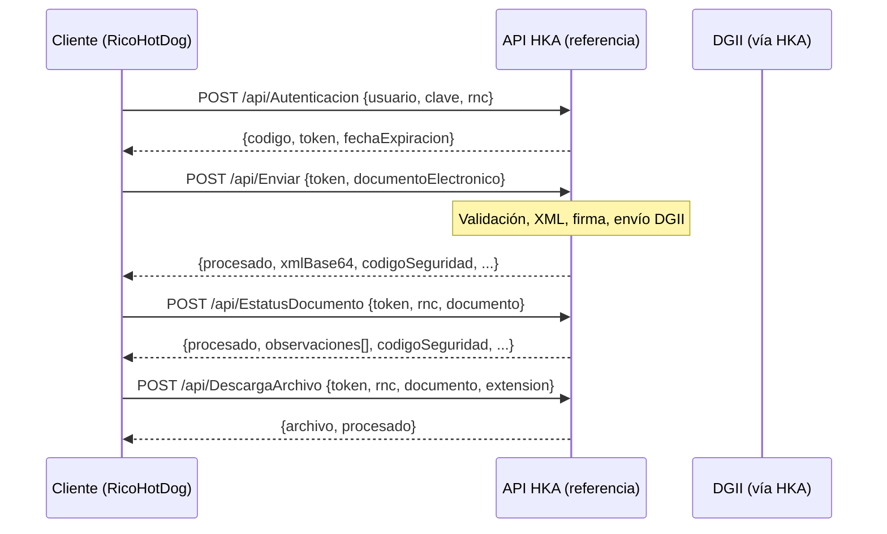

# Análisis del contrato API — The Factory HKA (Emisión DO)

**Proyecto:** Servicio de Facturación Electrónica para Sistemas Externos (ClinicRD)  
**Consumidor objetivo:** RicoHotDog  
**Fuente analizada:** [swagger.json demo](https://demoemision.thefactoryhka.com.do/swagger/v1/swagger.json)  
**Copia local de trabajo:** `_swagger_hka_raw.json` (misma ruta que este documento)  
**Fecha de análisis:** 2026-03-23  
**Alcance:** solo documentación — sin cambios a código, BD ni configuración.

---

## 1. Resumen del Swagger

| Campo | Valor |
|--------|--------|
| OpenAPI | **3.0.4** |
| Título | Api Emision DO - Demo |
| Versión API | v1 |
| Proveedor | THE FACTORY HKA SRL |
| **Endpoints (`paths`)** | **17** |
| Métodos HTTP | **Todos POST** (no hay GET/PUT/DELETE en paths) |
| Códigos HTTP documentados | **Solo `200`** en cada operación |
| `securitySchemes` | **Vacío** en el spec (no declara Bearer global) |
| Esquemas (`components.schemas`) | **62** modelos |
| Autenticación práctica | JWT obtenido en `/api/Autenticacion`; el **`token` viaja en el cuerpo JSON** de casi todas las demás operaciones junto con `rnc` u otros campos |

### Patrón de respuesta HKA

La mayoría de respuestas comparten:

- `codigo` (int32)
- `mensaje` (string)
- `procesado` (boolean), cuando aplica
- Campos específicos por operación (`token`, `xmlBase64`, `archivo`, `observaciones`, etc.)

### Patrón de solicitud (post-autenticación)

Tras `/api/Autenticacion`, las operaciones incluyen típicamente:

- `token` (string) — JWT devuelto por HKA
- `rnc` (string) — RNC del emisor, en operaciones por empresa

### Flujo de dependencias entre operaciones



**Operaciones de administración** (certificado, series, logo, licencias) pueden usarse en onboarding o mantenimiento, no necesariamente en cada venta.

---

## 2. Inventario de endpoints

| # | Método | Ruta | Tag | Resumen |
|---|--------|------|-----|---------|
| 1 | POST | `/api/Anulacion` | Anulacion | Anular secuencias del cliente |
| 2 | POST | `/api/Autenticacion` | Autenticacion | Obtener Token (JWT) |
| 3 | POST | `/api/CargaCertificado` | CargaCertificado | Actualiza el certificado del cliente |
| 4 | POST | `/api/ConsultaRNC` | ConsultaRNC | Consulta RNC |
| 5 | POST | `/api/DescargaArchivo` | DescargaArchivo | Descarga el archivo del documento enviado |
| 6 | POST | `/api/Enviar` | Enviar | Envíe el documento a ser procesado |
| 7 | POST | `/api/EnvioCorreo` | EnvioCorreo | Envíe por correo el documento electrónico |
| 8 | POST | `/api/EnvioCotizacion` | EnvioCotizacion | Envíe por correo (cotización) |
| 9 | POST | `/api/EstatusDocumento` | EstatusDocumento | Consulta el estatus de un documento |
| 10 | POST | `/api/EstatusLicencia` | EstatusLicencia | Consulta el estatus de licencia de folios |
| 11 | POST | `/api/EstatusLicencia/Lista` | EstatusLicencia | Lista de licencias de una empresa |
| 12 | POST | `/api/Logo` | Logo | Carga o actualiza el logo del cliente |
| 13 | POST | `/api/Series` | Series | Obtener todas las series |
| 14 | POST | `/api/Series/ActualizarSerie` | Series | Actualizar una serie existente |
| 15 | POST | `/api/Series/BorrarSerie` | Series | Borrar (desactivar) una serie |
| 16 | POST | `/api/Series/CrearSerie` | Series | Crear una nueva serie |
| 17 | POST | `/api/Series/ObtenerSucursales` | Series | Obtener todas las sucursales |

**Parámetros de ruta/query:** ninguno documentado; todo va en **request body** JSON.

**Content-Type:** `application/json`, `text/json`, `application/*+json` (equivalentes en el spec).

---

## 3. Esquemas de entrada y salida (operaciones críticas)

### 3.1 Autenticación — `POST /api/Autenticacion`

**Request** (`RequestAutenticacion`):

| Campo | Tipo | Obligatorio en spec |
|--------|------|---------------------|
| `usuario` | string | No marcado (`required` ausente en schema) |
| `clave` | string | Idem |
| `rnc` | string | Idem |

**Response** (`RespuestaAutenticacion`, HTTP 200):

| Campo | Tipo |
|--------|------|
| `codigo` | int32 |
| `mensaje` | string |
| `token` | string (JWT) |
| `fechaExpiracion` | string |

**Nota:** OpenAPI no marca campos `required`; en implementación HKA se asume que credenciales + RNC son necesarios para emitir token válido.

---

### 3.2 Enviar — `POST /api/Enviar`

**Request** (`RequestEnviar`):

| Campo | Tipo |
|--------|------|
| `token` | string |
| `documentoElectronico` | `DocumentoElectronico` (objeto anidado) |

**`DocumentoElectronico`** (resumen estructural):

| Sección | Contenido |
|---------|-----------|
| `encabezado` | `IdentificacionDocumento`, `Emisor`, `Comprador`, `Totales`, `OtraMoneda`, `Transporte`, etc. |
| `detallesItems[]` | Líneas: `indicadorFacturacion`, ITBIS, bienes/servicios, descuentos, impuestos adicionales, otra moneda |
| `subtotales[]`, `descuentosORecargos[]`, `paginacion[]` | Agregados fiscales |
| `informacionReferencia` | NC/ND (NCF modificado, código modificación) |
| `observaciones[]`, `cuotas[]` | Metadata / pagos a plazos |
| `serialDevice` | string (POS) |

**`IdentificacionDocumento`** (campos relevantes):

- `tipoDocumento`, `ncf` (puede venir vacío para asignación por proveedor)
- `fechaVencimientoSecuencia` (formato `dd-MM-yyyy`)
- `tipoIngresos`, `tipoPago`, `fechaLimitePago`, `tablaFormasPago[]`
- Indicadores: envío diferido, monto gravado, nota de crédito

**`Detalles`** (línea): soporta **ITBIS gravado** (`indicadorFacturacion`), retenciones, impuestos adicionales, minería, subcantidades — modelo **comercial completo**, no solo exento.

**Response** (`RespuestaEnviar`, HTTP 200):

| Campo | Tipo |
|--------|------|
| `codigo`, `mensaje` | int, string |
| `xmlBase64` | string |
| `procesado` | boolean |
| `codigoSeguridad` | string (código QR / timbre) |
| `fechaFirma`, `fechaEmision` | string |

HKA devuelve documento **ya procesado** (XML firmado y metadatos). ClinicRD hoy construye y firma localmente y habla con **DGII REST** directamente.

---

### 3.3 Estatus documento — `POST /api/EstatusDocumento`

**Request** (`RequestEstatusDocumento`):

| Campo | Tipo |
|--------|------|
| `token` | string |
| `rnc` | string |
| `documento` | string (identificador del comprobante en el lado HKA; **confirmar semántica con tráfico RicoHotDog**) |

**Response** (`RespuestaEstatusDocumento`):

| Campo | Tipo |
|--------|------|
| `codigo`, `mensaje`, `procesado` | |
| `observaciones[]` | `{ codigo, mensaje }` |
| `codigoSeguridad`, `fechaFirma`, `fechaEmision` | string |

Equivalente conceptual en ClinicRD: `consultar_resultado_ecf_dgii` + estado en `facturas_ecf`, pero **formato de respuesta distinto**.

---

### 3.4 Descarga archivo — `POST /api/DescargaArchivo`

**Request** (`RequestDescargaArchivo`):

| Campo | Tipo |
|--------|------|
| `token`, `rnc` | string |
| `documento` | string |
| `extension` | string (ej. xml, pdf — **confirmar valores con RicoHotDog**) |

**Response** (`RespuestaDescargaArchivo`):

| Campo | Tipo |
|--------|------|
| `codigo`, `mensaje` | |
| `archivo` | string (contenido codificado; spec no detalla si Base64) |
| `procesado` | boolean |

ClinicRD: PDF vía `ecf/printable.py` y rutas de factura médica; **no** expone API de descarga compatible HKA.

---

### 3.5 Anulación — `POST /api/Anulacion`

**Request** (`RequestAnulacionSecuencias`):

| Campo | Tipo |
|--------|------|
| `token` | string |
| `anulacion` | Objeto `Anulacion` (encabezado RNC, detalles de secuencias `ncfDesde`/`ncfHasta`, tipo documento) |

**Response** (`RespuestaAnulacionSecuencias`):

| Campo | Tipo |
|--------|------|
| `codigo`, `mensaje`, `procesado` | |
| `xmlBase64` | string |

**Importante:** el nombre y el modelo indican **anulación de secuencias/rangos**, no necesariamente el mismo flujo que una **nota de crédito electrónica (E34)** o anulación de un comprobante ya aceptado en DGII. Verificar qué invoca RicoHotDog.

---

### 3.6 Otras operaciones (resumen)

| Endpoint | Request principal | Response principal |
|----------|-------------------|-------------------|
| CargaCertificado | token, rnc, certificadoBase64, claveBase64 | codigo, mensaje, procesado |
| ConsultaRNC | token, rnc, rncConsultar | datos contribuyente (razón social, estado, régimen) |
| EnvioCorreo | token, rnc, correos[], documento | codigo, mensaje, procesado |
| EnvioCotizacion | + documentoBase64 | idem |
| EstatusLicencia / Lista | token, rnc, serial/licenciaId | folios, ciclos, disponible |
| Logo | token, rnc, logoBase64, operacion | logo, procesado |
| Series/* | token, rnc, serie (SeriesModel) | series[], sucursales |

---

## 4. Comparación con ClinicRD (código real)

### 4.1 Modelo de documentos

| Aspecto | HKA (`DocumentoElectronico`) | ClinicRD (flujo médico) |
|---------|------------------------------|-------------------------|
| Entrada | JSON estructurado comercial | Formulario + `pacientes_pendientes`, ARS |
| Persistencia venta | Lado cliente (RicoHotDog) | `facturas` + `factura_detalles` |
| Persistencia e-CF | Lado HKA | `facturas_ecf` (**UNIQUE factura_id**) |
| Tipos comprobante | `tipoDocumento` en JSON (31, 32, …) | Solo **E31** emitible (`SUPPORTED_ECF_TYPES`) |
| ITBIS gravado | Sí en líneas | Builder **rechaza** indicadores ≠ 4 (exento) |
| Secuencia NCF | Series API + posible NCF en encabezado | `ecf_secuencias` + `reserve_encf` en BD |
| Envío fiscal | Respuesta síncrona con xmlBase64 | `DGIIClient.submit_e31` + TrackID |
| Auth API | usuario/clave/rnc → JWT en body | Flask-Login + `tenant_id` sesión |
| Multi-empresa | `rnc` por request | `get_current_tenant_id()` |

### 4.2 Reutilización por componente

#### `ecf/builder.py`

- **Reutilizable:** validaciones de RNC, fechas, estructura E31 parcial.
- **Adaptación:** mapper `DocumentoElectronico` → parámetros `build_e31`; soporte **ITBIS 0–3**, bienes, `Totales`, `OtraMoneda`, NC (`informacionReferencia`).
- **Nuevo:** builders E32/E34 si RicoHotDog los usa.

#### `ecf/signer.py`

- **Reutilizable** casi íntegro para firmar XML generado.

#### `ecf/dgii.py`

- **Reutilizable** para autenticación semilla, envío, consulta TrackID/estado.
- **Nota:** solo valida patrones **E31** en `send_ecf` / `find_track_ids`.

#### `ecf/certificates.py`

- **Reutilizable** con certificados por tenant en volumen (`TenantCertificateProvider`).
- HKA permite **CargaCertificado** en API; ClinicRD usa archivos + `ecf_configuraciones` (no Base64 en API hoy).

#### `services/ecf_operations.py`

- **Reutilizable:** `procesar_envio_ecf_dgii`, `consultar_resultado_ecf_dgii`, política `REQUIERE_CONSULTA`, eventos.
- **Adaptación:** desacoplar de `factura_ecf_id` / `facturas`; entrada por **ID documento externo** (`ext_ecf_*`).
- **No reutilizar** tal cual: acoplamiento a `factura_id` y flujo post-commit en billing.

#### `core/tenant.py`

- **No reutilizable** directo para API externa (sesión de usuario médico).
- **Concepto reutilizable:** aislamiento por `tenant_id` tras resolver **RNC + credenciales integración** → `tenant_id` emisor.

---

## 5. Matriz de compatibilidad

| Endpoint HKA | Funcionalidad | Soporte actual ClinicRD | Trabajo requerido | Clasificación MVP |
|--------------|---------------|-------------------------|-------------------|-------------------|
| POST `/api/Autenticacion` | Login JWT por usuario/clave/RNC | No (solo Flask-Login interno) | API credenciales por integración; emitir JWT o token compatible; mapeo RNC→tenant | **MVP** — desarrollo nuevo |
| POST `/api/Enviar` | Validar JSON, XML, firmar, DGII, responder | Parcial: build/sign/DGII solo E31 exento médico | Mapper HKA→XML; tablas `ext_*`; respuesta `RespuestaEnviar`; idempotencia; ITBIS/tipos | **MVP** — adaptación + nuevo |
| POST `/api/EstatusDocumento` | Estado por `documento` | Parcial: consulta DGII por TrackID/e-NCF interno | Resolver `documento`; traducir a `RespuestaEstatusDocumento` + observaciones | **MVP** — adaptación |
| POST `/api/DescargaArchivo` | Devolver xml/pdf | Parcial: PDF E31 en UI médica | Almacenar XML firmado; generar PDF/QR; codificar `archivo` | **MVP** — adaptación (prioridad según RicoHotDog) |
| POST `/api/Anulacion` | Anulación secuencias | No | Modelo anulación DGII + mapper; distinto de NC E34 | Pendiente confirmar uso RicoHotDog |
| POST `/api/CargaCertificado` | Certificado Base64 | Parcial: carga manual admin/volumen | API segura + cifrado refs; opcional si cert lo administra ClinicRD | No MVP si cert preload |
| POST `/api/ConsultaRNC` | Consulta contribuyente | No | Integración DGII/ONAPI o cache; respuesta `RespuestaEstadoRNC` | Pendiente confirmar |
| POST `/api/EnvioCorreo` | Email comprobante | SMTP consultorio/plataforma, no API e-CF | Servicio correo + contrato HKA | No MVP salvo requisito |
| POST `/api/EnvioCotizacion` | Email cotización | No | Idem | No MVP |
| POST `/api/EstatusLicencia` | Folios HKA | No (licencias ClinicRD en `empresas`) | Modelo licencias técnicas o emular contadores | Pendiente confirmar |
| POST `/api/EstatusLicencia/Lista` | Lista licencias | No | Idem | Pendiente confirmar |
| POST `/api/Logo` | Logo en representación | Papelería médica | Almacenamiento logo por emisor API | No MVP |
| POST `/api/Series` | Listar series | Parcial: `ecf_secuencias` local | Exponer series en formato `SeriesModel` o sincronizar | Pendiente confirmar |
| POST `/api/Series/CrearSerie` | Alta serie | Parcial: UI catálogos `ecf_secuencias` | CRUD compatible + reglas DGII | Pendiente confirmar |
| POST `/api/Series/ActualizarSerie` | Modificar serie | Parcial | Idem | Pendiente confirmar |
| POST `/api/Series/BorrarSerie` | Desactivar serie | Parcial (activo/inactivo) | Idem | Pendiente confirmar |
| POST `/api/Series/ObtenerSucursales` | Sucursales HKA | No en e-CF | Tabla sucursales integración | Pendiente confirmar |

**Leyenda clasificación:**

- **Reutilizable:** motor DGII, firma, certificados, secuencias (lógica).
- **Requiere adaptación:** mismo motor, distinto contrato y persistencia.
- **Desarrollo nuevo:** autenticación API, capa HKA, tablas externas, mappers.
- **No MVP / pendiente:** confirmar con RicoHotDog (licencias, series, anulación, correo).

---

## 6. Diferencias técnicas clave

1. **Contrato de entrada:** HKA recibe **JSON comercial**; ClinicRD arma E31 desde **dominio médico** (ARS, pacientes, servicios exentos).
2. **Contrato de salida:** HKA responde con **códigos de negocio** (`codigo`, `procesado`) y **xmlBase64**; ClinicRD persiste TrackID y estados DGII en `facturas_ecf`.
3. **Autenticación:** HKA usa **JWT en el body**; ClinicRD usa **cookies de sesión** y permisos RBAC.
4. **Identificador `documento`:** en Estatus/Descarga no está definido en Swagger más allá del nombre del campo — debe alinearse con lo que RicoHotDog envía (e-NCF, GUID interno HKA, etc.).
5. **Códigos HTTP:** Swagger solo documenta 200; errores probablemente también 200 con `codigo` ≠ éxito — **validar con tráfico real**.
6. **Tipos e impuestos:** HKA modela ITBIS multi-tasa, otra moneda, retenciones; ClinicRD E31 médico es **exento**.
7. **Anulación vs NC:** endpoint `Anulacion` es por **secuencias**, no equivalente automático a nota de crédito electrónica.
8. **Licencias y series:** HKA gestiona folios/licencias en su plataforma; ClinicRD gestiona rangos en `ecf_secuencias` sin API espejo.
9. **Regla de negocio ClinicRD:** no crear `facturas` médicas ni `facturas_ecf` para documentos RicoHotDog — obligatorio **`ext_ecf_documents`** (o similar).

---

## 7. Arquitectura recomendada (sin tocar módulo médico)

### Ubicación

`integrations/external_ecf_service/` registrado en `app.py` **sin modificar** rutas de `routes/billing.py`.

### Capas

```text
integrations/external_ecf_service/
  routes/hka_compat.py      # POST /api/* espejo del Swagger (mismas rutas)
  auth/jwt_hka.py           # /api/Autenticacion
  adapters/
    hka_request.py          # Deserializa JSON → DocumentoCanónico
    hka_response.py         # DocumentoCanónico → RespuestaEnviar, etc.
  services/
    orchestrator.py         # idempotencia → secuencia → build → sign → dgii
    document_store.py       # ext_ecf_* (sin facturas médicas)
  facades/
    dgii.py                 # Wrapper sobre ecf.dgii + ecf_operations
    signing.py              # ecf.certificates + signer
```

### Resolución de emisor

1. `POST /api/Autenticacion` valida `usuario`+`clave`+`rnc` contra tabla `ext_integration_credentials`.
2. Se obtiene `tenant_id` del emisor RicoHotDog (empresa dedicada en `empresas` o binding explícito).
3. Certificado y secuencias: **`ecf_configuraciones` + `ecf_secuencias`** de ese tenant (mismo motor, distinto origen de datos).
4. Cada request subsiguiente valida `token` + coherencia `rnc` con el emisor del token.

### Compatibilidad URL RicoHotDog

- Base URL apunta al host ClinicRD; las rutas deben ser **`/api/...` idénticas** al Swagger (case-sensitive según ASP.NET: `EstatusDocumento`, `DescargaArchivo`, etc.).
- Entorno demo HKA: `demoemision.thefactoryhka.com.do` — reproducir path, no necesariamente el host.

### Idempotencia

- Clave derivada de `serialDevice`, `numeroFacturaInterna` del emisor, o hash estable del JSON — **confirmar con capturas RicoHotDog**.
- UNIQUE en BD antes de reservar e-NCF; reintentos devuelven misma `RespuestaEnviar` si ya `procesado`.

### Éxito honesto (regla ClinicRD/HKA)

- `procesado: true` solo si firma válida y (según política acordada) recepción DGII con evidencia o consulta de aceptación.
- Mapear errores DGII a `codigo`/`mensaje`/`observaciones[]` sin filtrar secretos.

---

## 8. Operaciones prioritarias (MVP RicoHotDog)

| Prioridad | Endpoint | Motivo |
|-----------|----------|--------|
| P0 | `/api/Autenticacion` | Prerequisito de todas las llamadas |
| P0 | `/api/Enviar` | Emisión en punto de venta |
| P0 | `/api/EstatusDocumento` | Reintentos y confirmación |
| P1 | `/api/DescargaArchivo` | Impresión / archivo fiscal |
| P2 | `/api/Series` y CRUD | Si RicoHotDog sincroniza series con HKA hoy |
| P2 | `/api/ConsultaRNC` | Si el POS valida comprador al facturar |
| P3 | Correo, Logo, Licencias, Anulación | Según matriz confirmada con cliente |

**Confirmación pendiente:** captura de configuración URL en RicoHotDog y log de 3–5 transacciones reales contra HKA demo/prod.

---

## 9. Riesgos y dependencias

| Riesgo | Impacto | Mitigación |
|--------|---------|------------|
| Swagger solo lista HTTP 200 | Errores mal manejados en cliente | Pruebas contra demo HKA; documentar códigos `codigo` observados |
| Semántica de `documento` desconocida | Estatus/Descarga rotos | Tráfico real + tests golden |
| RicoHotDog usa E32/consumo + ITBIS | MVP E31 exento insuficiente | Extender builder; ampliar `dgii` validaciones |
| `Anulacion` ≠ anulación de factura | Incumplimiento fiscal | Aclarar con negocio; posible E34 aparte |
| Licencias HKA | RicoHotDog podría llamar EstatusLicencia al arrancar | Emular respuesta o confirmar que no aplica |
| Prestación a terceros DGII | Regulatorio | Asesoría legal; certificado del **RNC RicoHotDog** |
| Regresión módulo médico | Producción ClinicRD | Cero cambios en `billing.py` en MVP; solo fachada nueva |
| JWT en body vs seguridad | Robo de token en logs | Redactar logs; HTTPS obligatorio; TTL corto |

**Dependencias:**

- Copia versionada del Swagger en repo (`docs/external_ecf/_swagger_hka_raw.json`).
- Tenant emisor con `ecf_configuraciones`, certificado en volumen, rangos E31+ en `ecf_secuencias`.
- Ambiente PRUEBAS DGII antes de producción.
- Evidencia de uso RicoHotDog (sin código fuente).

---

## 10. Plan de implementación (fases)

### Fase A — Contrato y pruebas (sin prod)

- **Objetivo:** Congelar spec HKA v1; fixtures JSON de `Enviar` desde RicoHotDog.
- **Entregables:** tests de contrato JSON Schema derivado del OpenAPI.
- **Aceptación:** lista P0/P1 firmada.

### Fase B — Persistencia externa + auth

- **Objetivo:** Tablas `ext_*`, `POST /api/Autenticacion` compatible.
- **Archivos nuevos:** `integrations/external_ecf_service/*`, migración SQL.
- **Sin tocar:** `routes/billing.py`.
- **Pruebas:** token inválido, RNC cruzado, sin filtración de claves.

### Fase C — Enviar (mapper + motor)

- **Objetivo:** `POST /api/Enviar` → build/sign/DGII → `RespuestaEnviar`.
- **Reutiliza:** `ecf/builder`, `signer`, `dgii`, `certificates`, lógica de `ecf_operations`.
- **Pruebas:** E31 exento y primer caso ITBIS; idempotencia.

### Fase D — Estatus + Descarga

- **Objetivo:** Paridad consulta y archivos.
- **Reutiliza:** `consultar_resultado_ecf_dgii`, `printable`, `qr`.

### Fase E — Series / RNC / Anulación (si aplica)

- Según matriz confirmada con RicoHotDog.

### Fase F — Staging RicoHotDog

- Cambio solo URL; monitoreo duplicados y errores `codigo`.

---

## Referencias internas ClinicRD

| Archivo | Rol |
|---------|-----|
| `ecf/builder.py` | XML E31 (exento, médico) |
| `ecf/signer.py` | Firma XMLDSig |
| `ecf/dgii.py` | Cliente DGII |
| `ecf/certificates.py` | PKCS#12 por tenant |
| `services/ecf_operations.py` | Envío y consulta |
| `core/tenant.py` | Aislamiento sesión web (referencia, no API) |
| `database_schema.sql` | `ecf_*`, `facturas_ecf` |

---

## Apéndice: archivo fuente

- URL: https://demoemision.thefactoryhka.com.do/swagger/v1/swagger.json  
- Descarga verificada en este análisis: **OpenAPI 3.0.4**, **17 paths**, **62 schemas**.

*Documento generado como entrega de auditoría. Implementación pendiente de aprobación.*
