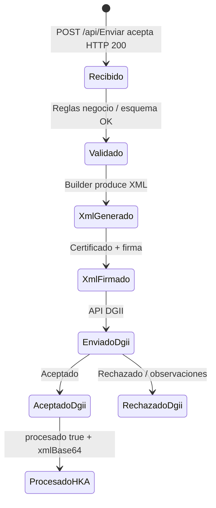

# Validación de compatibilidad — RicoHotDog ↔ ClinicRD (Fase 2)

**Proyecto:** Servicio de Facturación Electrónica para Sistemas Externos (ClinicRD)  
**Consumidor objetivo:** RicoHotDog (configuración de URL del proveedor HKA, sin acceso al código POS)  
**Fase actual:** 2 — recepción y registro (`POST /api/Enviar`), **sin emisión fiscal ni DGII**  
**Fecha:** 2026-11-13  

**Referencias internas:**

| Documento | Uso |
|-----------|-----|
| `docs/external_ecf/_swagger_hka_raw.json` | Contrato OpenAPI 3.0.4 (The Factory HKA — demo DO) |
| `docs/external_ecf/analisis_contrato_hka.md` | Auditoría de endpoints y brechas |
| `docs/external_ecf/revision_fase2.md` | Revisión técnica Fase 2 y riesgos `procesado` / `codigo` |
| `docs/external_ecf/fase2_recepcion.md` | Comportamiento implementado en ClinicRD |

**Restricciones de esta guía:** no modificar RicoHotDog; no DGII; no cambiar la respuesta actual de ClinicRD en Fase 2; no despliegue ni migraciones en producción como parte de este protocolo.

---

## 1. Objetivo de la validación

Confirmar **cómo RicoHotDog interpreta** las respuestas del proveedor de facturación electrónica compatibles con HKA, en particular:

- `codigo`
- `mensaje`
- `procesado`
- `xmlBase64`
- `codigoSeguridad`, `fechaFirma`, `fechaEmision`

La validación es **previa a autorizar Fase 3** (generación, firma y envío fiscal). No sustituye pruebas DGII; define criterios de éxito del **cliente POS**.

---

## 2. Modelo de estados del comprobante (semántica técnica)

Swagger HKA describe el **resultado de `POST /api/Enviar`** como `RespuestaEnviar`, sin desglosar estados intermedios. Para pruebas con RicoHotDog y planificación de Fase 3, ClinicRD usa el siguiente modelo **lógico** (no expuesto como campos separados en HKA):



| Estado lógico | Qué significa | Campos HKA típicos (emisión completa) | ClinicRD Fase 2 |
|---------------|---------------|----------------------------------------|-----------------|
| **Documento recibido** | El proveedor aceptó el JSON y lo persistió o encoló | HTTP 200; mensaje puede indicar recepción | **Sí** — registro en `ext_ecf_documents` |
| **Documento validado** | Estructura y reglas de negocio OK | No distinguido en OpenAPI; implícito si no hay error de `codigo` | **Sí** — mapper HKA + validaciones |
| **XML generado** | XML e-CF construido | No expuesto hasta respuesta final | **No** (Fase 3) |
| **XML firmado** | XML con firma digital | `xmlBase64`, `fechaFirma` | **No** (Fase 3) |
| **Enviado a DGII** | TrackID / recepción DGII | No en `RespuestaEnviar`; posible vía `EstatusDocumento` | **No** (Fase 3) |
| **Aceptado / rechazado DGII** | Resultado fiscal | `observaciones[]` en `EstatusDocumento`; `procesado` en Enviar según política HKA | **No** (Fase 3) |
| **Procesado (contrato HKA)** | Ciclo del proveedor terminado con artefactos listos | `procesado: true`, `xmlBase64` poblado, `codigoSeguridad` usualmente presente | **No** — Fase 2 responde `procesado: false` |

### Respuesta actual ClinicRD Fase 2 (baseline congelado para pruebas)

```json
{
  "codigo": 0,
  "mensaje": "Documento recibido; emisión fiscal pendiente",
  "xmlBase64": null,
  "procesado": false,
  "codigoSeguridad": null,
  "fechaFirma": null,
  "fechaEmision": "<fecha según documento, si aplica>"
}
```

Equivale a: **Recibido + Validado** en el modelo lógico; **no** equivale a **Procesado HKA** ni emisión fiscal.

---

## 3. Qué dice el Swagger (y qué no dice)

### Confirmado en OpenAPI (`_swagger_hka_raw.json`)

| Tema | Evidencia |
|------|-----------|
| Ruta y método | `POST /api/Enviar` — summary: *"Envíe el documento a ser procesado"* |
| Request | `token`, `documentoElectronico` |
| Response HTTP | Siempre **200** en spec (sin códigos HTTP de error documentados) |
| `RespuestaEnviar` | `codigo` (int32), `mensaje`, `xmlBase64`, `procesado` (bool), `codigoSeguridad`, `fechaFirma`, `fechaEmision` |
| Consulta posterior | `POST /api/EstatusDocumento` — `token`, `rnc`, `documento` → `procesado`, `observaciones[]`, metadatos |
| Autenticación previa | `POST /api/Autenticacion` → `token`, `fechaExpiracion` |

### No determinable solo con Swagger (requiere proveedor RicoHotDog o tráfico real)

| Tema | Por qué importa |
|------|-----------------|
| **Catálogo de `codigo`** | No hay enum ni tabla de valores; solo tipo `int32`. |
| **Regla de éxito en el POS** | ¿`codigo === 0` basta? ¿Exige `procesado === true`? ¿Exige `xmlBase64` no vacío? |
| **Semántica de `procesado: false` con `codigo: 0`** | OpenAPI no define combinaciones válidas. |
| **Uso de `mensaje`** | ¿Se muestra al cajero? ¿Se ignora? |
| **Campo `documento` en EstatusDocumento** | Identificador opaco; puede ser e-NCF, UUID interno HKA, número de factura interna, etc. |
| **Timeouts y reintentos** | No documentados en OpenAPI. |
| **Tipos e-CF en producción RicoHotDog** | E31, E32, NC, etc. |
| **`numeroFacturaInterna` / `numeroPedidoInterno`** | Si el POS los envía y si son únicos por venta. |
| **Impresión / QR** | Si el POS decodifica `xmlBase64` o solo usa `codigoSeguridad`. |

---

## 4. Preguntas para el proveedor de RicoHotDog

Enviar al integrador o soporte de RicoHotDog (o capturar en reunión técnica). Respuestas documentadas en la sección **7. Resultados**.

**Plantilla de correo lista para enviar:** `plantilla_correo_ricohotdog.md`.

### 4.1 Interpretación de `POST /api/Enviar`

1. Tras recibir HTTP 200 con `codigo: 0`, ¿el sistema considera la venta fiscalmente cerrada sin más condiciones?
2. ¿Validan explícitamente `procesado === true` antes de imprimir o liberar el ticket?
3. ¿Validan que `xmlBase64` no sea null ni vacío?
4. ¿Utilizan `codigoSeguridad`, `fechaFirma` o `fechaEmision` para impresión o QR?
5. ¿Muestran `mensaje` al usuario final cuando `codigo !== 0` o cuando `procesado` es false?
6. ¿Qué valores de `codigo` conocen además de `0` (lista o documentación interna)?
7. Para `codigo: 0` y `procesado: false`, ¿reintentan `Enviar`, llaman `EstatusDocumento`, o marcan error?

### 4.2 Reintentos y resiliencia

8. ¿Cuántos reintentos hacen a `Enviar` ante timeout de red?
9. ¿Timeout configurado (segundos) hacia el proveedor?
10. En reintento, ¿reenvían el mismo JSON completo?
11. ¿Llaman `POST /api/EstatusDocumento`? ¿En qué casos (timeout, duda, cierre de caja)?
12. ¿Qué valor envían en el campo `documento` de `EstatusDocumento`?

### 4.3 Payload de venta

13. ¿Envían `emisor.numeroFacturaInterna` o `numeroPedidoInterno` en cada ticket?
14. ¿El proveedor HKA asigna `ncf` vacío para que el servidor lo genere?
15. ¿Qué `tipoDocumento` usan en comercio (E32, etc.)?

### 4.4 Configuración

16. ¿Solo cambian la URL base del proveedor o también credenciales por pantalla?
17. ¿Usan ambiente demo HKA en pruebas? ¿URL exacta configurada hoy?
18. ¿Requieren otros endpoints P0 además de `Autenticacion` y `Enviar` antes de producción (`EstatusDocumento`, `DescargaArchivo`)?

### 4.5 Evidencia solicitada

19. Exportar o compartir **log de 3–5 transacciones** contra HKA (request/response redactados: sin claves, sin certificados).
20. Captura de pantalla de configuración “URL proveedor facturación electrónica”.

---

## 5. Matriz de pruebas de compatibilidad

**Entorno ClinicRD:** instancia local o staging con `EXTERNAL_ECF_ENABLED=true`, migración Fase 1+2 aplicada, seed de cliente/emisor/credencial.  
**Entorno RicoHotDog:** caja de pruebas apuntando a la URL de ClinicRD (solo si el integrador autoriza; si no, simular con Postman/curl y contrastar con comportamiento declarado del POS).

### Leyenda de resultado observado en RicoHotDog

| Código | Significado |
|--------|-------------|
| OK | Comportamiento aceptable para negocio |
| ERR | Error visible / venta bloqueada incorrectamente o venta cerrada incorrectamente |
| ? | Pendiente de ejecutar o de respuesta del proveedor |

| ID | Escenario | Origen respuesta | JSON clave (resumen) | Comportamiento esperado **ideal** POS | Riesgo si POS solo mira `codigo` | ClinicRD Fase 2 | Ejecutable en Fase 2 |
|----|-----------|------------------|----------------------|----------------------------------------|-----------------------------------|-----------------|----------------------|
| **T01** | Recepción sin emisión | ClinicRD real | `codigo:0`, `procesado:false`, `xmlBase64:null` | No cerrar venta fiscal; opcional mensaje “pendiente” | Venta cerrada como éxito | Implementado | **Sí** |
| **T02** | Emisión completa (referencia HKA) | Mock / HKA demo / Fase 3 futura | `codigo:0`, `procesado:true`, `xmlBase64` presente, `codigoSeguridad` presente | Cierre venta, impresión, QR | N/A | No disponible | **No** (simular con HKA demo o Postman) |
| **T03** | Error validación negocio | ClinicRD real | `codigo:2`, `procesado:false`, `mensaje` descriptivo | Error visible; no reintentar infinito sin corregir | Depende de lista `codigo` | Implementado (mapper) | **Sí** |
| **T04** | Token inválido | ClinicRD real | `codigo:1`, `procesado:false` | Reautenticar (`Autenticacion`) | N/A | Implementado | **Sí** |
| **T05** | Servicio deshabilitado | ClinicRD | `codigo:99` | Mensaje claro; no emitir | N/A | Config | **Sí** |
| **T06** | Reintento idéntico (misma venta) | ClinicRD real | Segunda llamada: misma respuesta lógica (idempotente) | No duplicar comprobante en UI | N/A | Implementado | **Sí** |
| **T07** | Timeout cliente | Simular (proxy/firewall) | Sin respuesta / cortar TCP | ¿EstatusDocumento o reintento? | Duplicado o venta colgada | N/A | **Parcial** (simular red) |
| **T08** | `EstatusDocumento` tras T01 | ClinicRD | Fase 2: **endpoint no implementado** | Si POS lo exige → error | Bloqueo POS | **No** | **No** (documentar gap) |
| **T09** | e-NCF duplicado distinto contenido | ClinicRD | `codigo:2` | Error de negocio | N/A | Implementado | **Sí** |
| **T10** | Auth + Enviar flujo completo | ClinicRD | Secuencia P0 | Igual que con HKA | N/A | Fase 1+2 | **Sí** |

### Procedimiento recomendado por caso (sin DGII)

**T01 — Baseline Fase 2 (crítico)**

1. `POST /api/Autenticacion` con credenciales de prueba.
2. `POST /api/Enviar` con `documentoElectronico` representativo (preferir el mismo perfil que enviarían a HKA: tipo, ITBIS, comprador).
3. Registrar en tabla de resultados: pantalla POS, impresión, estado de caja, mensajes.
4. **Criterio preliminar:** si el POS marca venta como **emitida** con T01 → **bloquear Fase 3 en prod** hasta ajuste cliente o respuesta; ver §6.

**T02 — Referencia oro (HKA demo)**

1. Misma venta contra `https://demoemision.thefactoryhka.com.do/api/Enviar` (credenciales demo HKA).
2. Guardar respuesta completa como **golden file** (redactado).
3. Comparar campos con T01; documentar diferencias.

**T03 / T04 / T09**

- Forzar payload inválido (RNC emisor distinto al token), token expirado, o mismo `ncf` con otro contenido.
- Verificar que RicoHotDog no cierre venta.

**T06**

- Repetir `Enviar` sin cambiar JSON dentro de 60 s.
- ClinicRD debe responder idempotente; POS no debe duplicar.

**T07**

- Cortar red a mitad de request (herramienta externa); observar si POS reintenta y si segundo intento es idempotente (T06).

---

## 6. Criterios de aceptación para autorizar Fase 3

Fase 3 **no** debe iniciarse en producción hasta cumplir **todos** los criterios marcados como obligatorios (O). Recomendados (R) mejoran calidad.

| ID | Criterio | Tipo | Evidencia |
|----|----------|------|-----------|
| **A1** | Proveedor RicoHotDog documenta regla de éxito (`codigo` / `procesado` / `xmlBase64`) | O | Respuesta escrita §7 o correo |
| **A2** | T01 ejecutado: comportamiento POS documentado (no solo “funciona”) | O | Fila en §7 + captura/log |
| **A3** | Si T01 cierra venta como emitida → plan acordado (cambio POS **fuera de alcance ClinicRD** o esperar Fase 3 con respuesta completa antes de URL prod) | O | Acta reunión |
| **A4** | T02 golden HKA demo archivado en repo (`docs/external_ecf/fixtures/` — futuro) | R | JSON redactado |
| **A5** | Lista de endpoints P0 confirmada (mínimo: Auth, Enviar; frecuente: EstatusDocumento) | O | Respuesta proveedor |
| **A6** | Si exigen `EstatusDocumento`, Fase 3 incluye diseño de ese endpoint antes de go-live | O | Backlog Fase 3/4 |
| **A7** | Confirmación de campos únicos de venta (`numeroFacturaInterna`) | R | Respuesta proveedor |
| **A8** | Pruebas T03, T04, T06 pasan sin falsos positivos en POS | O | Matriz §7 |
| **A9** | Staging ClinicRD: 20 tests automatizados en verde (`revision_fase2.md`) | O | CI local |
| **A10** | Política acordada: ClinicRD solo enviará `procesado: true` con XML firmado y política DGII definida | O | `revision_fase2.md` + diseño Fase 3 |

**Decisión:**

- **Aprobar diseño e inicio Fase 3:** A1, A2, A3 (sin bloqueo), A5, A8, A9, A10 satisfechos.
- **Aplazar Fase 3:** T01 con resultado ERR, o A5 indica dependencia de `EstatusDocumento` sin plan.

---

## 7. Plantilla de registro de resultados

Completar durante las pruebas (copiar filas según necesidad).

| ID | Fecha | Ejecutor | Entorno URL | Resultado POS | ¿Venta cerrada? | ¿Reintento? | ¿Estatus llamado? | Notas |
|----|-------|----------|-------------|---------------|-----------------|-------------|-------------------|-------|
| T01 | | | | ? | | | | |
| T02 | | | | | | | | |
| T03 | | | | | | | | |
| … | | | | | | | | |

**Respuestas proveedor RicoHotDog (resumen):**

| Pregunta §4 | Respuesta | Fecha |
|-------------|-----------|-------|
| 1–7 (Enviar) | | |
| 8–12 (Reintentos) | | |
| 13–15 (Payload) | | |
| 16–18 (Config) | | |
| 19–20 (Evidencia) | | |

---

## 8. Scripts de apoyo (ClinicRD, sin cambiar respuesta Fase 2)

Solo para pruebas manuales desde Postman o PowerShell; no sustituyen T01 en RicoHotDog.

```powershell
# 1) Autenticación
$auth = @{
  usuario = "TU_USUARIO_API"
  clave   = "TU_CLAVE_API"
  rnc     = "RNC_EMISOR"
} | ConvertTo-Json
$tokenResp = Invoke-RestMethod -Method Post `
  -Uri "http://127.0.0.1:5000/api/Autenticacion" `
  -Body $auth -ContentType "application/json"
$token = $tokenResp.token

# 2) Enviar (Fase 2 — esperar procesado: false)
# Cargar documentoElectronico desde fixture o captura HKA redactada
$enviar = @{
  token = $token
  documentoElectronico = @{ encabezado = @{ /* ... */ } }
} | ConvertTo-Json -Depth 20
Invoke-RestMethod -Method Post `
  -Uri "http://127.0.0.1:5000/api/Enviar" `
  -Body $enviar -ContentType "application/json"
```

Comparar salida con golden T02 (HKA demo) campo a campo.

---

## 9. Brechas conocidas ClinicRD vs HKA MVP RicoHotDog

| Endpoint HKA | ClinicRD Fase 2 | Impacto prueba RicoHotDog |
|--------------|-----------------|---------------------------|
| `POST /api/Autenticacion` | Implementado | Ninguno |
| `POST /api/Enviar` | Implementado (recepción) | T01 define riesgo principal |
| `POST /api/EstatusDocumento` | No implementado | T08 — puede fallar si POS lo exige tras timeout |
| `POST /api/DescargaArchivo` | No implementado | Impresión posteriores |
| Emisión XML + DGII | No | T02 solo vía HKA demo o Fase 3 |

---

## 10. Resumen ejecutivo para dirección técnica

1. **Fase 2 cumple** contrato HTTP y forma JSON de `RespuestaEnviar`, pero representa solo **recibido + validado**, no emisión HKA completa.
2. **Swagger no define** cómo RicoHotDog debe combinar `codigo` y `procesado`; la validación con el **proveedor del POS es obligatoria** (§4).
3. La prueba **T01** es la puerta de entrada: `procesado: false` debe provocar comportamiento seguro en caja; si no, no cambiar URL en producción hasta Fase 3 lista o acuerdo con integrador.
4. **T02** contra HKA demo establece la línea base de éxito real (`procesado: true` + XML).
5. **Fase 3** se autoriza con criterios §6; posible condicionante: implementar `EstatusDocumento` si el POS lo requiere.

---

*Documento generado como entregable de preparación. No modifica código ni respuestas del servicio.*
